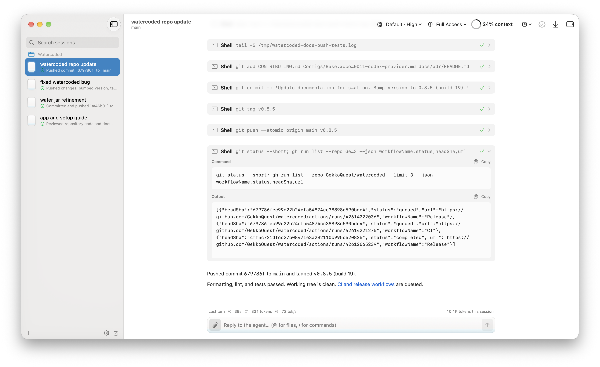
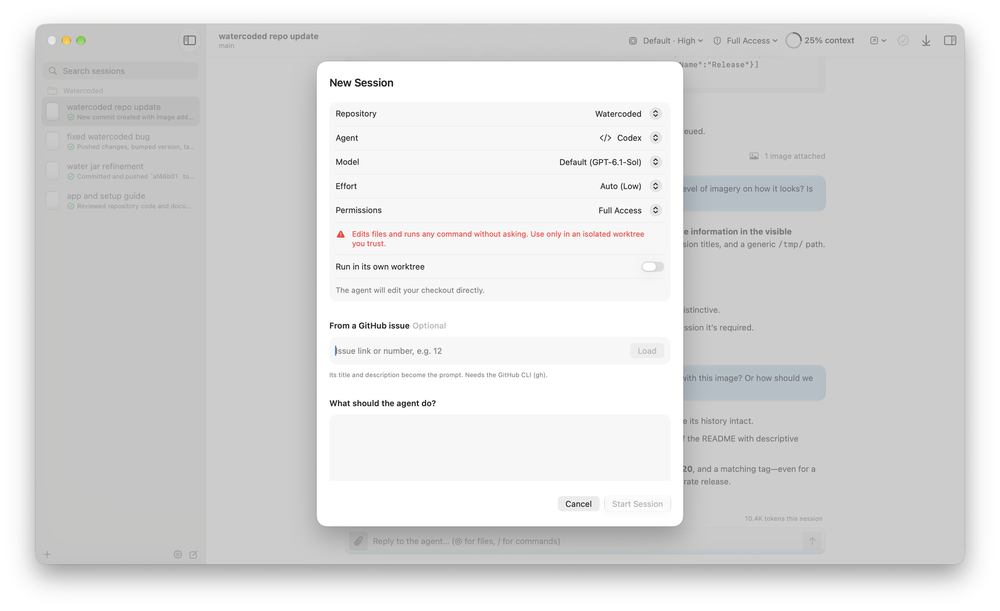

# Watercoded

[](https://github.com/GekkoQuest/watercoded/actions/workflows/ci.yml)
[](LICENSE)

**A native macOS home for your coding agents, where the interface behaves like water and the water carries information.**



Run the coding agents you already use (Claude Code and Codex today, with more providers to come) in parallel, each in its own git worktree. Each session's message box fills with water as the agent works, and a small glass next to the session in the sidebar shows the same thing at a glance:

| Water | Meaning |
|---|---|
| How full it is | How much of the model's context window the conversation uses |
| Ripples | The agent is writing a reply |
| Drops falling in | Tool calls; bigger drops for edits and commands |
| A droplet hanging from the top | The agent is waiting for your approval. It falls in when you allow, and evaporates when you deny. |
| Murky water | Your check (Verify) or the agent's last test or build failed, or the turn failed |
| Rising bubbles | Subagents at work |
| A burst of bubbles as the level drops | The conversation was compacted |
| Light frost | The prompt cache expired, so the next turn re-reads the whole context |
| Heat haze | A subscription limit is over 80% used, or an API-key session has spent more than $5 |
| Frost, and the water stops moving | The session is archived |

Drag the window and the water sloshes. Shake it and you're offered to stop the agent.
Reduce Motion is respected: the water stays still and only the level changes. Help ▸ What the Water Means has the same list.

> **Status:** early (v0.11). Tagged versions publish app downloads to
> [GitHub Releases](https://github.com/GekkoQuest/watercoded/releases). Installed releases offer updates in the app.
> The longer-term vision and roadmap are in [`docs/SPEC.md`](docs/SPEC.md).

v0.11 adds a new-session button beside each repository in the sidebar. Draft image attachments appear
above the prompt box, and sent images align with user messages without generated placeholder text.

## What it does

### Working with agents

- **Parallel agents, isolated:** each session runs in its own git worktree and branch, or in your checkout if you prefer.
- **Approvals everywhere:** in the app, from the menu bar, or straight from a macOS notification (Allow / Deny),
  with a Dock badge counting what's waiting. "Always allow" rules per repository are suggested after repeat approvals.
- **Plans and questions as cards:** Plan mode ends in a plan you can **Build** or send back with feedback;
  questions appear as cards with single-choice options, Claude's multiple selections, and custom written answers.
  Codex's async questions stay answerable while work continues and after the turn ends; an Answer shortcut above
  the message box brings a pending question into view.
- **Progress you can read:** the agent's task list shows as "3 of 7" above the conversation and in the sidebar;
  subagent steps are nested under their Task. A line above the message box shows the turn's time, output tokens
  and tokens per second.
- **Live settings:** switch model, effort or permissions mid-session. Models are listed by exact version
  ("Default (Opus 5.5)"), and Auto effort shows the model's default ("Auto (Medium)"). Any custom model name works too.
- **A real composer:** `@` to mention files, `/` for shared session commands and the agent's additional commands,
  and image attachments with providers that enable them (currently Codex). Click an image thumbnail to preview,
  copy or save it, before sending or later in the conversation. Newly sent images remain available after relaunch.
- **Links that open:** web links open in your browser; local file links open in Watercoded with Markdown, text
  or Quick Look previews. Relative paths use the session's folder, and source links highlight the requested line.
- **Agents delegate to agents:** ask one agent to hand part of the work to another, in any direction (Claude Code →
  Codex, Codex → Claude Code, or another model of the same agent): "have GPT-6.1-Sol write the migration". Helpers
  run as their own sessions under the first, each in its own copy of the folder, so several can work at once while
  the first keeps going. Their approvals show as usual; when one finishes, its changes are applied back (never over
  edits made meanwhile) and its answer goes to the agent that asked.
- **Branch a turn:** right-click a message to branch from it, or edit and resend it, in a new worktree with the
  files and conversation from that point. The original session is untouched. Claude Code discards older
  conversation checkpoints during compaction, so those turns can still be reviewed but cannot be branched;
  branch from a newer turn instead. Codex keeps older checkpoints available after compaction.
- **Agents outlive the app:** Claude Code and Codex keep working under background relays by default; Watercoded
  reconnects on launch, including approvals that arrived while it was closed. Settings ▸ General can turn this
  off for agents started afterward. If an agent was stopped, **Resume** picks its conversation back up.
- **On-device titles and summaries:** Apple Intelligence names sessions and summarizes progress, privately
  and without spending tokens (when Apple Intelligence is available).

### Reviewing and shipping

- **Review loop:** the Changes inspector defaults to uncommitted changes, with whole-session history (including
  commits) and individual turns available separately. It refreshes while open, reverts files or hunks,
  sends a hunk to the agent with a question, and opens files in your editor. Comment on several changes and send
  them as one review.
- **Verify for real:** set a check command per repository (e.g. `npm test`). Watercoded runs it itself, from the
  toolbar or after every turn that edits files, and the water turns murky when it fails. Without one, you're warned
  when the agent edited files but ran no tests.
- **Land:** commit (message drafted on-device), then merge into your branch or push and open a pull request,
  and clean up the worktree. If merging would conflict, one click asks the agent to rebase and resolve.
- **From issue to merged:** start a session from a GitHub issue; Land's pull request closes it. Watercoded then
  watches the PR's checks and reviews, notifies you, and can ask the agent to fix failures or address feedback.

### Setting up repositories

- **Ready-to-go worktrees:** per repository, clone ignored files like `.env` or `node_modules` into each new
  worktree (instant APFS copies, opt-in per item) and run a setup script before the agent starts.
- **Extra folders:** let agents read and edit folders outside the repository, such as a shared library.
- **See what the agent sees:** the Setup inspector lists its MCP servers, instruction files, skills and rules.
- **MCP forms:** when an MCP server asks for input (a short form, or a link to sign in), it appears as a card in the
  conversation; your answers go straight back to the tool. Works with Claude Code and Codex.

### Getting around

- **Find anything:** search every session (⇧⌘F); export any session as Markdown; re-run it on another model.
- **Bring your history:** import sessions you ran with the Claude Code or Codex CLI in a repository.
- **Leave anytime:** Continue in Terminal resumes the session in its folder with the agent's own CLI
  (`claude --resume` or `codex resume`).
- **Storage:** Settings ▸ Storage lists worktrees by size and removes unused ones (branches are kept).
- **Replay scripts:** save any finished session as a replayable demo or test fixture.

### Composer commands

Type `/` to browse commands, click one or press Tab to insert it, then Return to run it.
Claude Code and Codex share these commands:

| Command | Action |
|---|---|
| `/help` | List available commands, including provider additions |
| `/status` | Show session settings and context usage |
| `/compact` | Ask the provider to compact its conversation history |
| `/goal [objective\|clear]` | Inspect, set or clear a native provider goal; setting one starts work |
| `/plan [prompt]` | Enable native planning mode, optionally starting with a prompt |
| `/model [name\|default]` | List models or change the selection |
| `/effort [level\|auto]` | List reasoning levels or change the selection |
| `/mode [name]` | Show or change permissions; Full Access uses the permissions menu's confirmation |
| `/stop` | Interrupt the current turn |
| `/verify` | Run the repository's configured check, when one is set |

Commands appear according to session capabilities. Settings changes and compaction wait for an idle
agent; `/help`, `/status`, `/stop`, and goal inspection/clearing also work during a turn. Invalid
commands keep the draft and show an explanation. Additional provider commands pass through as messages.
Goal evaluation and continuation belong to the provider; Watercoded does not add its own goal loop.

## Requirements

- macOS 26 or later (Liquid Glass), on Apple silicon or a supported Intel Mac
- **For repositories and the demo:** `git` on your `PATH`. If `git --version` prompts to install Apple
  Command Line Tools, complete that installation; the full Xcode app is only needed to build Watercoded.
- **To build from source:** Xcode 26 or later, **opened once** (so it finishes installing components and you accept the license)
- **To build from source:** [Homebrew](https://brew.sh)

Optional:

- **For real agents**, one or both of:
  - the [Codex CLI](https://developers.openai.com/codex/cli), signed in with `codex login` (ChatGPT or an API key).
    Tested with Codex **0.167.0**. Watercoded uses Codex's app server, which OpenAI marks experimental.
  - the [Claude Code CLI](https://code.claude.com/docs/en/setup), installed and signed in.
    Tested with Claude Code **2.1.319**. Watercoded relies on parts of the CLI that aren't documented.

  Other versions may behave differently; `make doctor` and Settings ▸ Agents warn when yours differs.
  The built-in demo needs neither and spends no tokens.
- **Apple Intelligence:** names sessions, summarizes progress and drafts commit messages. Without it, sessions
  are named from your first message, there are no progress summaries, and the commit message starts as the
  session's title.
- **[GitHub CLI](https://cli.github.com) (`gh`), signed in:** lets **Land** open pull requests directly, and is
  needed to start from an issue and to watch pull requests. Without it, Land pushes the branch and opens the pull
  request page in your browser.

## Getting started

### Install a release (recommended)

1. Open the [latest release](https://github.com/GekkoQuest/watercoded/releases/latest) and download
   **Watercoded-<version>.zip** from **Assets** (the source-code archives are for developers).
2. Extract the ZIP and move **Watercoded.app** to `/Applications` (or `~/Applications`).
3. Open the installed app. Releases are ad-hoc signed and not notarized. If macOS blocks the first launch,
   go to **System Settings ▸ Privacy & Security ▸ Open Anyway**, then confirm opening Watercoded.
4. Click **Try the Demo**, or install and sign in to an agent CLI listed above, then use
   **Add Repository…** (⇧⌘O) and **New Session…** (⌘N).

<details>
<summary>Session setup preview</summary>



Choose permissions and whether to use a worktree for each session. This screenshot shows Full Access
with the worktree option off; new installations default to Ask and their own worktree.

</details>

You do not need Homebrew or the full Xcode app to run a release. The ZIP includes both Apple silicon and
Intel executables. Help ▸ What the Water Means (⇧⌘/) explains the water.

Release builds check on launch and every 10 minutes when automatic checks are enabled. An update icon
beside Settings shows when one is available; hover to see the version and click to review and install.
**Watercoded ▸ Check for Updates…** checks manually. Installing an update requires confirmation.
See [installation and update details](docs/RELEASING.md).

### Build from source

To build from source on a brand-new Mac:

```bash
git clone https://github.com/GekkoQuest/watercoded.git
cd watercoded
xcode-select -p          # should print /Applications/Xcode.app/Contents/Developer
                         # if not: sudo xcode-select -s /Applications/Xcode.app
make doctor              # checks everything below and tells you how to fix what's missing
make bootstrap           # installs XcodeGen, SwiftFormat, SwiftLint and the Metal Toolchain; generates the project
make run                 # builds and launches Watercoded Development (Debug)
```

Debug builds are called **Watercoded Development** and do not check for app updates. They share session
data and worktrees with the installed release, so use one app at a time. For an installed Release build,
run `make install` and open Watercoded from Applications. See [CONTRIBUTING.md](CONTRIBUTING.md) for development conventions.

Other tasks (`make help` lists them all):

```bash
make test        # package test suite (Swift Testing)
make lint        # SwiftFormat --lint + SwiftLint --strict
make format      # apply formatting
make icon        # regenerate the app icon
make install     # build Release and install in /Applications
open Watercoded.xcodeproj   # after `make generate`
```

## What Watercoded creates

Outside your repositories:

| Location | What |
|---|---|
| `~/Library/Application Support/Watercoded/` | Your repositories list, sessions and transcripts |
| `~/.watercoded/worktrees/` | One per session that runs in its own worktree |
| `~/.watercoded/replays/` | Saved replay scripts |
| `~/.watercoded/demo/` | Sample git repository created by Try the Demo |
| `~/.watercoded/sessions/` | Logs for agents running in the background (cleaned up when stopped or their exit is handled by the app) |
| `~/.watercoded/delegation/` | Requests and results for agents delegating to other agents |
| `~/Library/Preferences/dev.watercoded.app.plist` | Release app preferences (managed by macOS) |

Inside each repository you add:

- branches named `watercoded/<name>`, one per session that runs in its own worktree
- snapshot commits under `refs/watercoded/<session-id>/turn-<n>-before` and `-after`, which power per-turn diffs,
  reverts and branching

Creating a worktree creates its branch; snapshots create hidden refs. **Land** commits, merges or pushes
when you ask it to. Agents can also edit files, commit or push through their own tools according to the
session's permissions. Sessions in your checkout edit that checkout directly.

Settings ▸ Storage removes worktrees you no longer need; their branches are kept.

### Removing it

Before removing Watercoded, finish or stop its agents and preserve any work you want to keep. Quitting alone
leaves background agents running. Settings ▸ Storage can remove archived and unused worktrees; removal
keeps branches and committed work, but deletes uncommitted and ignored files in those folders.

Quit the app and delete it from Applications. If you want to delete all session data, transcripts, replays,
delegation files and remaining worktree folders, remove:

```bash
rm -rf ~/.watercoded ~/Library/Application\ Support/Watercoded
```

After the worktree folders are gone, run the following **in each repository you added**:

```bash
git worktree prune
git for-each-ref --format='%(refname)' refs/watercoded/ | while IFS= read -r ref; do
    git update-ref -d "$ref"
done
git branch --list 'watercoded/*'   # review, then delete unwanted branches with git branch -d
```

Deleting snapshot refs removes Watercoded's per-turn recovery history. Only use `git branch -D` if you
intend to discard unmerged commits. To remove preferences too, use `defaults delete dev.watercoded.app`
(and `defaults delete dev.watercoded.app.debug` if you used development builds). Locally installed builds
may also leave recovery copies in `.watercoded-backups.noindex` inside the installation folder.

## Usage and billing

Watercoded runs the agent CLI you signed in to, so usage counts against *your* plan:

- **Claude subscription (Pro/Max):** the usage popover shows your plan's 5-hour and weekly limits. Nothing is billed per token.
- **ChatGPT plan (Codex):** the usage popover shows your plan's limits as Codex reports them.
- **API key:** the popover shows the cost the CLI reports (Claude Code).

The line above the message box shows each turn's output tokens and speed, plus the session's total.

## Troubleshooting

| Problem | Fix |
|---|---|
| `make bootstrap` fails with license or "first launch" errors | Open Xcode once, or run `sudo xcodebuild -license accept && sudo xcodebuild -runFirstLaunch`. |
| `cannot execute tool 'metal' due to missing Metal Toolchain` | `xcodebuild -downloadComponent MetalToolchain` |
| Claude Code shows "Not installed" | Install the CLI, then click **Check Again** (Settings ▸ Agents). Watercoded re-reads your shell's `PATH`, so no relaunch is needed. |
| Claude Code is installed but the agent fails immediately | Run `claude` once in Terminal and sign in. |
| Codex shows "Unavailable" | Run `codex login` in Terminal, then click **Check Again** (Settings ▸ Agents). |
| Land says Git doesn't know who you are | `git config --global user.name "Your Name"` and `git config --global user.email you@example.com` |
| Land couldn't open the pull request automatically | Install and sign in to the GitHub CLI (`brew install gh && gh auth login`); until then the branch is pushed and the PR page opens in your browser. |
| "isn't a git repository" when adding a folder | Choose **Initialize Repository**, or pick the repository's root folder. |
| "Run in its own worktree" is unavailable | The repository has no commits yet. Make a first commit, or let the agent work in your checkout. |
| Settings ▸ Agents says your Claude Code version differs | It may still work. Watercoded is tested with 2.1.319; if something breaks, please open an issue with your version. |
| "Couldn't load the issue" | Check that `gh auth status` is signed in and the repository's remote is on GitHub. |
| A pull request's status never updates | Watching uses `gh`; sign in with `gh auth login`. Use **Check Now** on the session's pull request banner. |
| Worktree setup failed | Its output is in the session as a "Worktree setup" step. Fix the script in the repository's settings; the agent starts anyway. |

## Architecture at a glance

```
App (composition root)
 └─ WatercodedUI ─┬─ WatercodedDesign ── Meniscus (water engine: physics + Metal)
                  └─ Orchestrator ─┬─ AgentKit ── ProcessKit ── WatercodedCore
                                   └─ GitKit ──── ProcessKit
Providers (plug-ins): ClaudeCodeProvider · CodexProvider · ReplayProvider · …
OnDeviceIntelligence: titles, summaries and commit messages with Apple's on-device model
```

Each AI provider is its own module behind the `AgentProvider` protocol. Adding one never touches the UI or the orchestration. See [`docs/ARCHITECTURE.md`](docs/ARCHITECTURE.md).

## Privacy and credentials

Watercoded does not manage provider logins or credential storage. It launches the CLIs you installed and
signed in to, so authentication stays with the provider's own tool. Transcripts, attached images and background logs are
stored locally and can contain prompts, tool output and sensitive data returned by tools. Exporting a
session or opening a pull request can share session content; review it before sharing. Telemetry: none.
Release builds contact GitHub to check for app updates and download updates you approve. See
[SECURITY.md](SECURITY.md) for the permission and storage model.

## License

[MIT](LICENSE)
